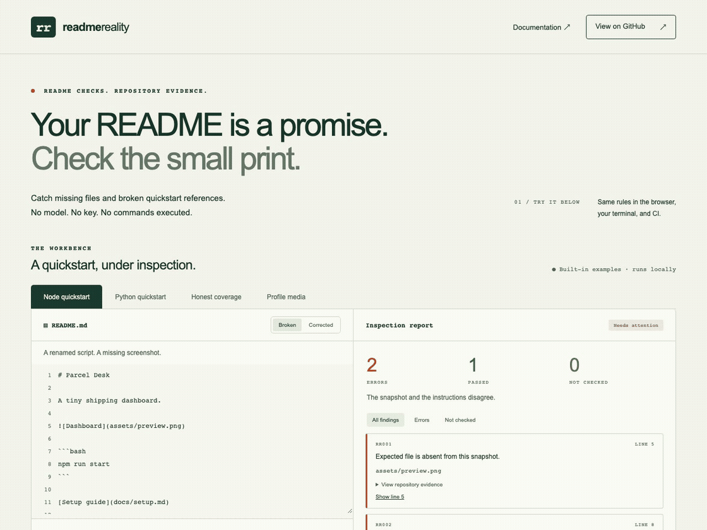

# Readme Reality

**Catch broken quickstarts before your users do.**

An offline README checker. Find missing local references, undeclared package scripts and missing Python/requirements paths—with line numbers and repository evidence. No model, API key or code upload. It never executes README commands.

[Try the interactive examples](https://rockenzo.github.io/readme-reality/) · [Download v0.1.0](https://github.com/RockENZO/readme-reality/releases/tag/v0.1.0) · [中文说明](docs/README.zh-CN.md)



The browser walkthrough uses labelled fictional snapshots and the same deterministic engine as the CLI and Action. [Capture provenance](docs/demo-recording.json). It is not a scan of a remote repository or a runtime test of an application.

## Start with a release bundle

Requires **Node.js 22.12+**. No project dependencies are installed by the checker.

Download `readme-reality-0.1.0.tgz` from the release, extract it, and run the bundled entry point against your checkout:

```bash
# From the extracted release's package directory:
node dist/cli.mjs check /path/to/your-repository
node dist/cli.mjs check /path/to/your-repository --format json
node dist/cli.mjs check /path/to/your-repository --readme docs/start.md
```

The planned npm package name is `@rockenzo/readme-reality`. **This release is distributed through GitHub Releases; the npm package is not published.** Do not use an assumed `npx` installation until a later release explicitly announces npm availability.

Example output:

```text
Readme Reality · FAILED
1 passed · 1 errors · 0 not checked

✗ README.md:8 RR002 npm run start
  Named script is not declared as a nonempty string.
  Evidence: package.json. Candidates: dev, build
```

This output illustrates the format. Findings from your run identify your actual snapshot.

## GitHub Action

```yaml
name: Check README
on: [pull_request, push]
permissions:
  contents: read
jobs:
  readme:
    runs-on: ubuntu-latest
    steps:
      - uses: actions/checkout@v4
      - uses: RockENZO/readme-reality@v0.1.0
        with:
          root: .
          readme: README.md
```

For stronger version pinning, replace the release tag with its reviewed full commit SHA. The Action uses Node 24, runs the same engine, creates workflow annotations and a Job Summary, and outputs `errors`, `skipped` and `status`. It does not post comments, commit changes, install target-project dependencies or open PRs. Subdirectory roots must stay inside the checked-out workspace.

## What is checked?

| Rule | Supported reference | Evidence |
| --- | --- | --- |
| RR001 | Markdown links/images, including reference-style links | Local file or directory exists; link paths resolve relative to the Markdown document |
| RR002 | `npm run NAME`, `pnpm run NAME`, `yarn run NAME` | Nonempty string in `scripts` of the nearest in-root ancestor `package.json` |
| RR003 | `python path.py`, `python3 "path with spaces.py"` | Regular script file exists |
| RR004 | `pip install -r path`, `--requirement path`, `--requirement=path`; also `python -m pip` | Requirements file exists |
| RR005 | Simple literal `cd directory` | Directory exists and becomes the working directory for the rest of that block |
| RR000 | Unsupported commands or code blocks | Explicitly recorded as not checked |

Shell commands are parsed only in `bash`, `sh`, `shell`, `console` or `zsh` fenced blocks. Each block starts at the repository root; state is not carried between blocks. Links in another Markdown file still resolve relative to that file. Only that selected Markdown file is scanned, not every linked document.

External links, host-root URLs and fragment-only references are not fetched; anchors are not validated. HTML links/images, indented code and package-manager shorthand are not supported. Literal unquoted trailing backslash continuations are joined, preserving the first source line. Complex shell, variables, substitutions, workspace selectors, package-manager option variants (including directory overrides), previous-directory navigation (`cd -`), npm built-in/default lifecycle behavior and third-party Python modules are skipped. Environment-prefixed setup commands are not simulated. A complex shell line or a simulated setup operation such as `git clone` makes subsequent working-directory-dependent checks in that block unknown. Use a separate root-relative block for subsequent supported checks.

Missing files mean **absent from this checked-out snapshot**. Generated/downloaded artifacts and environment-dependent paths may need documented prerequisites; the checker does not simulate them. Existing candidates are hints, never automatic fixes.

## Results and exit codes

- `0`: no confirmed errors. Read the coverage counts; this can still be `partial`.
- `1`: at least one confirmed snapshot error.
- `2`: input or tool failure, such as a missing/oversized README or invalid CLI arguments.

JSON has `schemaVersion: 1`, the selected `file`, `status` (`passed`, `failed`, `partial`), `summary` and ordered `findings`. Each finding includes its rule, outcome, README line, subject, evidence and candidate suggestions. An input with no supported references has partial coverage, not a claim of verification.

**A green check does not prove the quickstart runs.** The checker does not execute commands, validate installed modules, interpret application behavior, assess model quality or verify a checkpoint's contents. A Git LFS pointer existing on disk does not demonstrate that model weights are available.

## Privacy and boundaries

The scanning engine makes no network requests and sends no telemetry. Dependency installation, GitHub Actions and opening the hosted demo are separate network activities. Only the selected Markdown and necessary `package.json` files are read as text; file evidence is metadata. Symlinks and special files are not followed. Outside-root paths are refused. Text inputs are limited to 2 MB each; invalid UTF-8 is rejected by the disk adapter.

This is a static checker, not an OS sandbox. Scan a stable checkout: concurrent changes to directory topology are outside its security guarantee. Do not intentionally pass credential files or untrusted mounts as input. The checker has no write/fix mode. CI reports do not include script bodies or file contents.

## Develop

```bash
npm ci
npm run verify
npm run dev
```

Open the local URL ending in `/readme-reality/`. Browser tests require a local Chromium installation managed by Playwright:

```bash
npx playwright install chromium
npm run build:web
npx playwright test
```

`npm run build` produces a bundled CLI, public core module/types and a checked-in bundled Action. `npm run build:web` creates the static site. [Architecture and contracts](docs/ARCHITECTURE.md) · [Validation evidence](docs/VALIDATION.md) · [How to contribute](CONTRIBUTING.md).

## Related work

[DocGuard](https://github.com/raccioly/docguard) offers broader canonical documentation governance and deterministic checks. [Doc-Sentinel AI](https://github.com/reem-sab/doc-sentinel-ai) uses model-assisted code/documentation drift analysis. [Lychee](https://github.com/lycheeverse/lychee) is a dedicated link checker. These projects have overlapping capabilities; Readme Reality concentrates on a small, offline quickstart check with explicit abstention and no required configuration. It does not replace them or claim to be the first documentation checker.

MIT. Bundled parser dependencies retain their licenses in [third-party notices](THIRD_PARTY_NOTICES.md).
