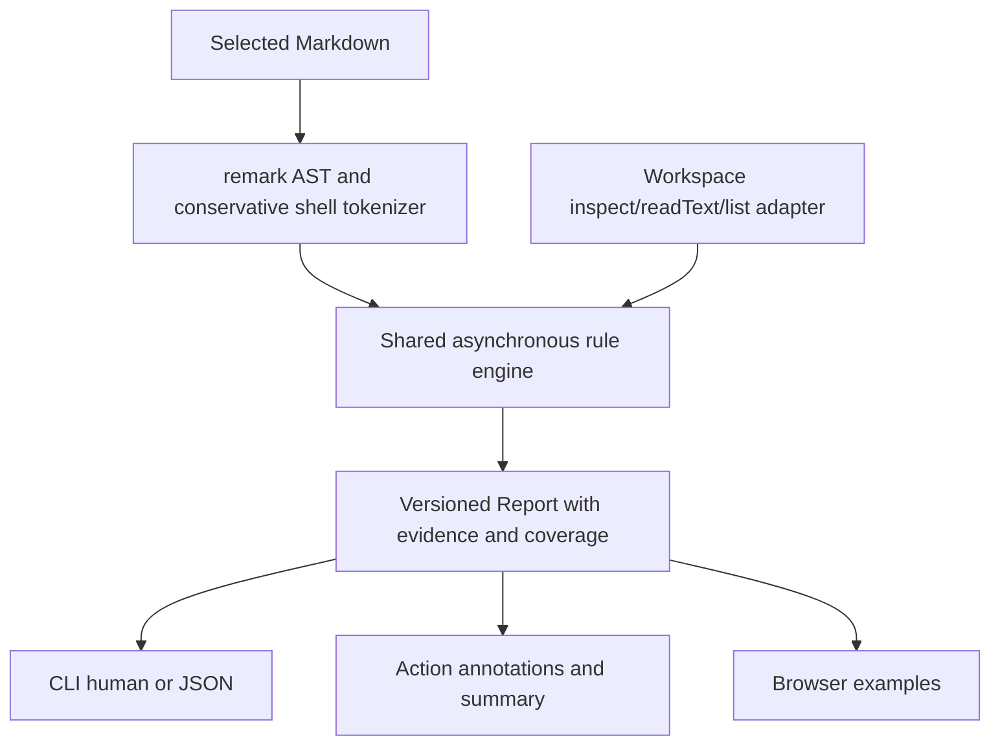

# Architecture and interfaces

- `src/core.ts`: browser-compatible rules, types and in-memory snapshot adapter. It does not import filesystem, subprocess or network APIs.
- `src/workspace.ts`: Node filesystem adapter; regular-file metadata, bounded UTF-8 reads, symlink refusal. Only Markdown and manifests are requested as text. Directory listings provide bounded candidate names.
- `src/report.ts`: terminal-control sanitization, workflow property escaping and HTML-safe summary output.
- `src/cli.ts` and `src/action.ts`: adapters over the same engine. The Action constrains the canonical selected root to the canonical GitHub workspace.
- `web/`: labelled, editable examples. Files are in-memory fictional snapshots. Text is rendered with DOM textContent, not as executable Markdown HTML. No server or database.

## Public core

`analyze(workspace, readme?) -> Promise<Report>` accepts `inspect(path)`, `readText(path)` and `list(directory)` methods. Paths are normalized repository-relative POSIX strings; the adapter must enforce its own filesystem boundary. `memoryWorkspace(files)` implements the browser/test adapter. The bundled ESM module and declarations are exported by the release package.

A report has schemaVersion1, file, status, summary and findings. Findings carry rule/outcome/file/line/subject/message/evidence/suggestions. `partial` means skips or no supported checks. Confirmed errors take precedence over partial status. No field is a runtime-success attestation.

The core is intentionally conservative. There is no general shell interpreter, module resolver, workspace simulation, generated-file model, network crawler or autofix. Unknown shell state invalidates subsequent path checks in that block. A root-independent source document may contain valid prerequisites that a static checkout alone cannot establish; users should read evidence rather than equate a finding with proof of runtime failure.

## Compatibility and trust

Node22.12+ is the supported CLI baseline; the Action uses GitHub's Node24 runtime. The browser and Node adapters return the same report schema. Runtime parser code is bundled; build dependencies are pinned by package-lock. Third-party notices accompany releases.

This is read-only application logic, not an isolation boundary against a malicious process simultaneously replacing parent directories. Use stable checkouts. Symlink refusal, regular-file checks and before/after file metadata checks reduce accidental/racy reads but do not replace OS isolation.

## HTML references (v0.2.0)

`src/html.ts` masks non-HTML Markdown while preserving offsets/newlines, then parses raw HTML using pinned parse5. This keeps inline tag context across Markdown AST nodes and prevents fenced/inline code from becoming references. An iterative tree walk extracts only supported HTML URL attributes; entity decoding and attribute locations come from the parser. Inert children are excluded. Unsupported attributes and base semantics abstain. Core feeds supported URLs to the same repository-contained RR001 path rule used by Markdown; CLI, bundled Action and browser remain one engine. No HTML is executed or inserted into a DOM.
